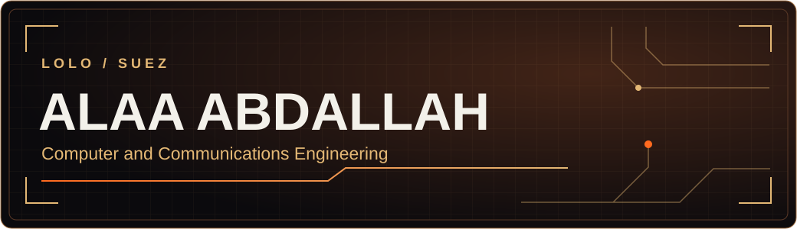
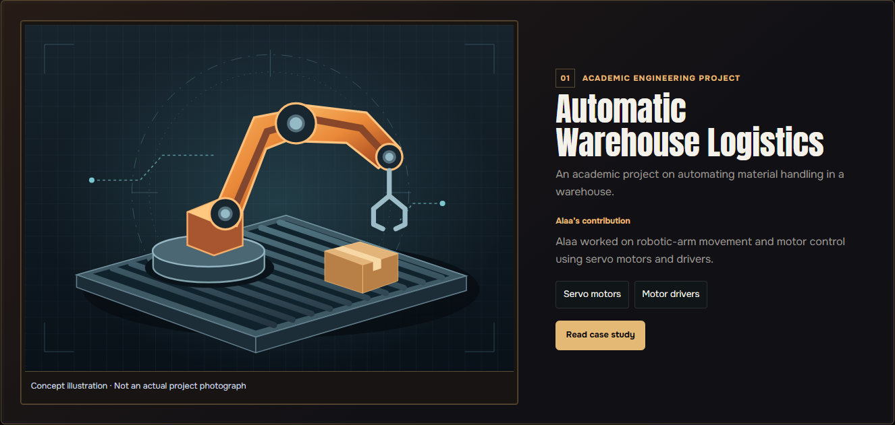

<p align="center"></p>

# LOLO · Alaa Abdallah Portfolio

A bilingual engineering portfolio for Alaa Abdallah, a Computer and Communications Engineering graduate from El Shorouk Academy (2025).

## What the site covers

- English and German portfolio, with responsive navigation and reduced-motion support
- About, educational progression, individual skills, and the Automatic Warehouse Logistics case study
- Huawei learning records, engineering interests, and a graduation timeline
- A local private preview for approved personal photography and profile material

## Portfolio preview



## Development

Use the Node version specified in `package.json` and pnpm 11.25.0.

```powershell
pnpm install --frozen-lockfile
pnpm dev
```

The default development server uses HTTPS at `https://localhost:3000`. Use `pnpm dev:http` for an explicit local HTTP fallback.

```powershell
pnpm lint
pnpm typecheck
pnpm test
pnpm build
```

The implementation uses Next.js, React, TypeScript, Tailwind CSS, GSAP, Motion and Radix UI. The warehouse illustration represents the project concept. It does not depict the original hardware.

## Preview configuration

The public source runs without personal data. To enable approved contact
channels in local development, copy `.env.example` to `.env.local` and set the
preview fields you need. Personal photographs, certificate scans, CV files and
date-of-birth data are stored outside the public source. The production build
does not render those previews.

## Release checklist

Use screenshots from a reviewed public build. The local private preview includes materials that are unavailable in the production build. Deployment and a public repository license require the owner’s approval.
